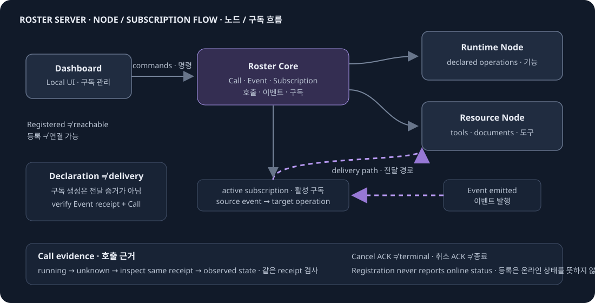
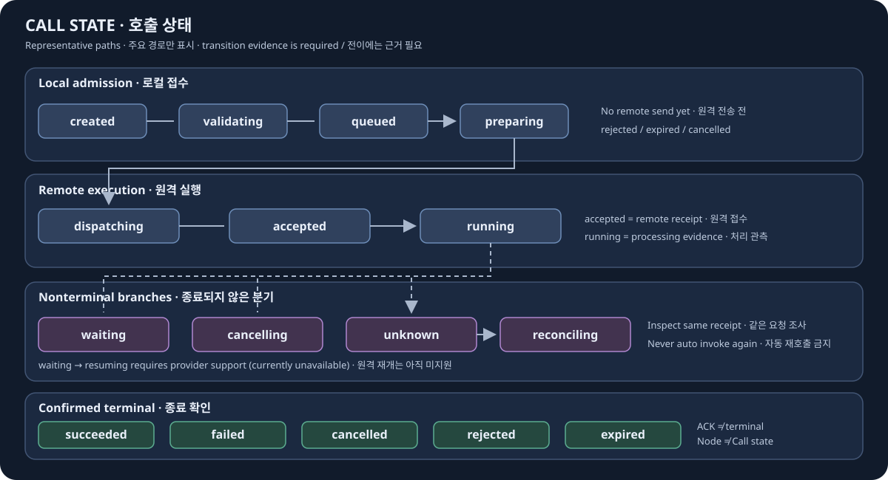

# Roster Server

[English](README.md) | [한국어](README.ko.md)

Run the central Go Core with its local dashboard and optional log service. The Core registers provider-neutral Nodes, accepts Calls, observes results, and routes events through explicit subscription declarations. The dashboard can create a subscription declaration and remove one using its current revision; it does not submit Calls.





## Run locally

Requirements: Go 1.26, Node.js 24, and npm. Run each service in a separate terminal from the repository root.

```sh
cd core
go run ./cmd/roster serve
```

```sh
cd dashboard
npm ci
npm run build
npm start
```

Open <http://127.0.0.1:7360>. Core listens at `127.0.0.1:7350`; the dashboard gateway reads Core data server-side. Relations can create a subscription declaration or remove one with its observed revision. Call submission is a separate Core CLI action.

## Start prepared services together

Build the Core binary from `core/` with `go build -o roster-core.exe ./cmd/roster`, and build the dashboard from `dashboard/` with `npm ci && npm run build`. Create owner-only config and environment JSON files **outside this repository**, then run from the repository root:

```sh
node scripts/launch.mjs --config ../local-config/server.json
```

The config uses `schema: "roster-launch/1"`, `data_root`, `env_file`, `core_binary`, and `dashboard_entry` (the absolute path to `dashboard/build/src/gateway.js`). Add optional `authority_file` to point to an owner-only policy JSON outside the repository; the launcher passes its path to Core. The env file has the shape `{ "env": {} }` for an empty Core. If importing Nodes that use credentials, allowlist the Core token environment names with `core_token_env`; keep values in the external env file. Core and dashboard bind to loopback ports 7350 and 7360. The launcher checks readiness, owns only its child processes, and keeps data and locks outside Git. Grouped startup and shutdown are verified in Linux Docker; native Windows ACL and signal behavior remain unverified.

## Inspect Nodes and Calls

Use the same Core command registry from CLI, HTTP, and MCP. From `core/`:

```sh
printf '%s\n' '{}' | go run ./cmd/roster core.status --file -
printf '%s\n' '{}' | go run ./cmd/roster nodes.list --file -
```

Start [Roster Node Client](https://github.com/roster-framework/roster-node-client) before registering its Runtime or Resource Node. Use `nodes.register` or a local Core configuration. `core/examples/local-stack.json` is a fixture: set Node IDs, target IDs, provider URLs, and `token_env` names for your environment. Put credential values in the Core process environment, never in a Node binding, manifest, or Git.

Calls use `calls.submit`, `calls.get`, `calls.list`, `calls.inspect`, and `calls.abort`. Core starts with an empty, fail-closed call policy when `--authority`/`authority_file` is omitted: readiness and reads work, while Call submission and human Abort are denied. Grant only exact principals, Nodes, actions, and operations. A minimal local grant looks like:

```json
{
  "schema": "roster-authority/1",
  "grants": [
    { "principal": { "namespace": "operators", "id": "local" }, "action": "invoke", "target": { "namespace": "nodes", "id": "runtime" }, "operations": ["run"] },
    { "principal": { "namespace": "operators", "id": "local" }, "action": "abort", "target": { "namespace": "nodes", "id": "runtime" }, "operations": ["run"] }
  ]
}
```

This policy file contains no credentials. A disconnect or timeout can leave a Call `unknown`; inspect the same receipt before deciding what to do. Registering a provider does not prove it is reachable. A subscription declaration configures future event routing but does not prove delivery. Verify the Event receipt and resulting Call evidence in Core logs. Removing a subscription does not cancel existing Calls.

## Import a community bundle

A community package can declare Nodes and subscriptions for explicit operator import. Install an exact package version in a dedicated provider workspace without running install scripts, then run its provider separately:

```sh
npm install --ignore-scripts --save-exact <name>@<version>
```

Build `dashboard/`, then validate and explicitly apply the package from the repository root. `<bindings.json>` maps declared `binding_ref` names to provider origins, target IDs, and **environment variable names** (`token_env`), never credential values. Copy the digest from `validate` into `import`. Inspect `applied` and `unresolved` before any manual follow-up; import may be partial. The importer does not execute package code or retry Calls.

```sh
node dashboard/build/src/cli.js bundle validate --package <installed-package-dir> --bindings <bindings.json> --core http://127.0.0.1:7350
node dashboard/build/src/cli.js bundle import --package <installed-package-dir> --bindings <bindings.json> --core http://127.0.0.1:7350 --apply --expected-digest <validated-sha256>
```

## Provision a Runtime agent and Core bundle

The deployment CLI validates Runtime ManagedAgent versions and existing skill/MCP/Resource references before applying Runtime CAS updates and then the referenced Core bundle. It does not provision providers or invoke a model. See the bilingual [Dashboard guide](dashboard/README.md) for the `roster-deployment/1` JSON example and commands.

```sh
node dashboard/build/src/cli.js deployment validate --file <deployment.json>
node dashboard/build/src/cli.js deployment apply --file <deployment.json> --expected-digest <validated-sha256>
```

## Verify

Run module checks from `core/` and `log/` separately in Docker:

```sh
docker run --rm -v "$PWD:/src:ro" -w /src golang:1.26 go test ./...
```

Run the dashboard suite from `dashboard/` with `npm test`. To exercise real Runtime and Resource HTTP, subscriptions, one-to-one replies, and a group conversation without a model call, first build `../roster-node-client/runtime`, then run this isolated Docker fixture from the repository root:

```sh
pwsh -File core/scripts/verify-isolated.ps1
```

Component guides: [Core](core/README.md), [Dashboard](dashboard/README.md), and [Log](log/README.md). Contribution guidance: [CONTRIBUTING](CONTRIBUTING.md).
